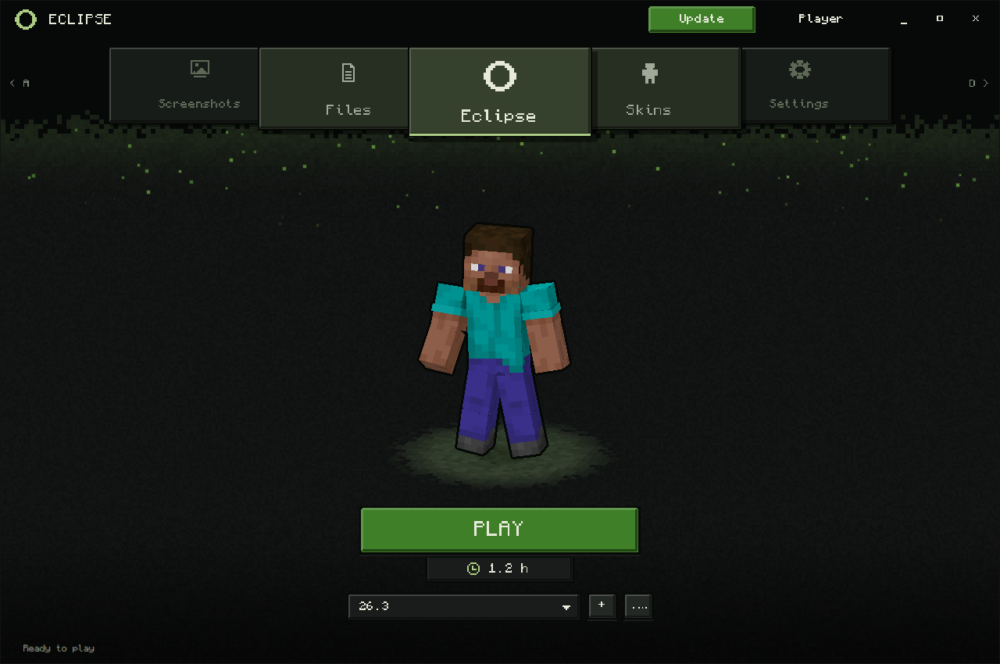

# Eclipse Launcher

[Download for Windows](https://github.com/deluti/eclipse-launcher/releases/latest/download/eclipse-launcher-windows-x86.exe) · [Releases](https://github.com/deluti/eclipse-launcher/releases) · [Русский](README.ru.md)

A fast, native Minecraft **Java Edition** launcher for Windows. Built with C# / .NET 10 and WinForms, without Electron, WebView, ads or a news feed.



## Install and play

1. Download **eclipse-launcher-windows-x86.exe** from the latest release.
2. Install Eclipse and open it from the Start menu.
3. Open **Settings**, choose your sign-in method and nickname, and save.
4. Select a Minecraft version and press **PLAY**, or press **Space** on the home tab.

The x86 launcher includes its own .NET runtime. Minecraft and the downloaded Java runtime require **Windows 10 2004+ or Windows 11 x64**. A separate .NET installation is unnecessary for release installers. Installation works for the current user without administrator rights; the desktop shortcut is optional.

English is the default, including when upgrading older settings. Choose **English** or **Русский** under **Settings → Language**. The language applies immediately and is remembered. Other settings still use **Save**.

## Features

- **Minecraft 1.18+**, with automatic downloads from official Minecraft servers and verified file hashes.
- **Fabric and Quilt** installation using the **+** button next to the version selector. Each modded profile has its own worlds, mods, options and screenshots.
- **Reusable skin library**: import a PNG on the Skins tab, select Classic or Slim arms, then Apply. Saved skins can be selected again without reimporting.
- **Named profile copies**: use **…** next to the version selector to create independent copies of any Vanilla, Fabric or Quilt version, or rename the selected profile. Mods and settings can be copied; worlds are optional.
- **3D skin and cape preview**, with Steve before sign-in, two standing poses, idle animation, a pixel platform and a character outline. Drag to rotate, scroll to zoom, double-click to reset the camera.
- **Screenshots** gallery with recent images and a full-size viewer.
- **Files** tree with text editing and quick access to the active profile's mods folder.
- **Settings** for language, nickname, sign-in method, memory, window size, fullscreen, launcher minimization and interface sounds.
- **Automatic memory budget** based on available physical/commit memory, Java and the installed mod count. Existing manual allocations remain manual; the saved manual value survives switching modes. GPU inspection is read-only.
- **Quiet game-time mode** stops animation and its worker thread even if the launcher stays visible, cancels background cosmetic/update requests, releases render/preparation caches and stops the sound worker. Animation resumes when the game exits.
- **Playtime counter** below PLAY. It tracks the running game, not launcher idle time or downloads, and saves every 30 seconds and when the game closes.
- **One-click updates**: startup checks the latest stable GitHub release in the background. A green **Update** button appears to the left of your nickname when a newer version is available. The installer is verified by size and SHA-256 before execution.
- Pixel UI with an embedded **Monocraft** font, English and Russian text, green particles and quiet action sounds. The animation loop targets **120 FPS**, including mouse rotation; actual performance depends on the computer and display.

Navigate tabs with **A / D**, then **Enter**, or click a tab. Text fields retain normal typing behavior. The active tab stays centered; cards share their top edge and overlap according to depth. PLAY sits above the playtime plaque.

## Sign-in methods

**Local nickname** uses a separate local profile with a stable `OfflinePlayer:<nickname>` UUID. It does not access Microsoft credentials or verify game ownership. It is enabled by default; the initial nickname is `Player`.

**Microsoft** signs in through the system browser using OAuth authorization code + PKCE, then Xbox Live, XSTS and Minecraft Services. This mode verifies Minecraft Java ownership and the player profile before launching. Passwords are entered only on Microsoft's website. Authentication failure never switches to local mode automatically.

Microsoft sign-in and appearance changes require a registered application Client ID with Minecraft API approval. The configured application has previously received `403 / Invalid app registration`; see [application setup](MINECRAFT-API-REQUEST.md). A valid player license alone does not grant an application access to the API. Players do not need to register applications or enter a Client ID themselves.

Skins and capes are loaded from the authenticated profile. Only owned capes can be equipped. The API does not provide the official launcher's complete skin history; Eclipse also remembers skins previously seen for that player.

Imported PNGs stay in `data/appearance/local-skins`, with their model and local selection in `data/appearance/library.json`. In **Microsoft** mode, Apply uploads the selected PNG through the official authenticated Minecraft API. In **Local nickname** mode, Apply saves the launcher preview; **Default** restores Steve. Starting with **0.5.0**, Eclipse does not inject skin code into the game, download skin helpers, or run a texture server. Previously saved skins remain available. Local custom skins therefore affect only the launcher preview; the game uses its own default skin behavior.

Profile copies use stable IDs in `data/instances`. Shared assets, libraries and Java are reused. Renaming changes only the displayed name, preserving paths and worlds. Copying worlds is disabled by default; the original profile remains available.

## Updating and keeping your data

From version 0.2.0 onward, use the green **Update** button when it appears. Eclipse downloads and verifies the installer, closes, updates the existing application folder, and opens again with the same data directory. Update checks never block the first window or PLAY.

For the first upgrade from 0.1.0, download the latest installer and select the **existing Eclipse folder**. The installer recognizes the previous version and offers to update it. It keeps worlds, mods, profiles, screenshots, settings, playtime and Microsoft application configuration. Uninstalling the launcher also keeps game data.

Data is stored in `data` beside `Eclipse.exe`:

| Location | Contents |
| --- | --- |
| `data/game` | Shared assets, libraries and vanilla game files |
| `data/instances/<profile-id>` | Modded profile game directories |
| `data/playtime.json` | Total recorded game time |
| `data/settings.json` | Launcher preferences, including language |
| `data/session.bin` | Microsoft session encrypted with Windows DPAPI |

Use `Eclipse.exe --data-dir "D:\MinecraftData"` for a custom directory. Updates preserve this choice. The existing `%APPDATA%/.minecraft` folder and its accounts are not imported or modified.

Tokens are encrypted for the current Windows user. The game receives the access token as a process argument when required; it is excluded from the JVM argument file and redacted in launcher logs.

## Build and test

Requirements: Windows and the .NET 10 SDK. The application has no third-party NuGet dependencies. `NuGet.Config` disables package sources for normal development builds.

```powershell
.\build.ps1 -Test
```

Or run the checks directly:

```powershell
dotnet build Eclipse.slnx -c Release -m:1
dotnet run --project tests/Eclipse.Tests -c Release
dotnet run --project tests/Eclipse.Tests -c Release -- --ui-en .test-data/ui-en
dotnet run --project tests/Eclipse.Tests -c Release -- --ui .test-data/ui-ru
```

Tests cover authentication contracts, ownership checks, verified downloads, path handling, settings, skins/capes, mod loaders, playtime, updater integrity, localization and UI layout. Network authentication responses in unit tests are fixtures; passing tests do not establish real Microsoft sign-in or API approval.

The development build in `artifacts/Eclipse` is framework-dependent and requires the Windows Desktop Runtime 10 x64. Release installers are self-contained.

### Windows installer

Install [Inno Setup 6 or 7](https://jrsoftware.org/isinfo.php), then run:

```powershell
.\tools\Build-WindowsRelease.ps1 -Version 0.5.0
```

The script downloads official .NET 10.0.15 runtime packs from NuGet.org, publishes `win-x86` with ReadyToRun, includes runtime/font notices, and produces:

- `artifacts/release/eclipse-launcher-windows-x86.exe`
- `artifacts/release/SHA256SUMS.txt`

Use `-IsccPath` to select the Inno Setup compiler. Game files and personal sessions are never included. GitHub Actions builds tagged `v<version>` releases and supports manual builds through **Actions → Windows release**.

The integration script `tools/Test-WindowsUpgrade.ps1` verifies upgrades in isolated copies with a separate installer registration and no test shortcuts. Existing user installation metadata and its Start menu shortcut are checked for changes.

## Performance and credits

See [performance architecture, measurements and limitations](PERFORMANCE.md). Local measurements are saved in `data/diagnostics/startup.json` and `launch.json`; they contain technical timing/resource data and are never uploaded. The launcher keeps official HotSpot GC defaults and does not change mods, Minecraft graphics/options/resource packs, Windows power/security settings, GPU preferences or process priority. Compatible official Java is chosen from each Minecraft version's metadata and checked locally without a `java -version` subprocess on every launch.

Eclipse paints its first window before network requests or session decryption. Cached launch plans avoid repeated metadata requests. Downloads run in parallel and reuse verified unchanged files. Java launches directly with a JVM argument file and the selected memory limit. Game and mod initialization time is determined by Minecraft, Java and the computer.

The embedded [Monocraft](https://github.com/IdreesInc/Monocraft) font supports both languages and is distributed under the SIL Open Font License; its license is included in the source and installer. .NET notices are included with self-contained releases. Minecraft and Java are downloaded from official sources when installing a game version. Eclipse is an independent project and is not affiliated with Mojang or Microsoft.
